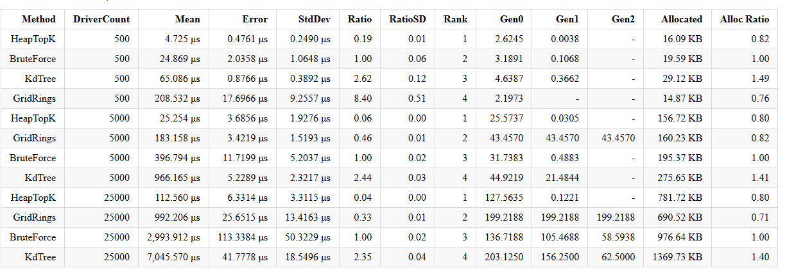
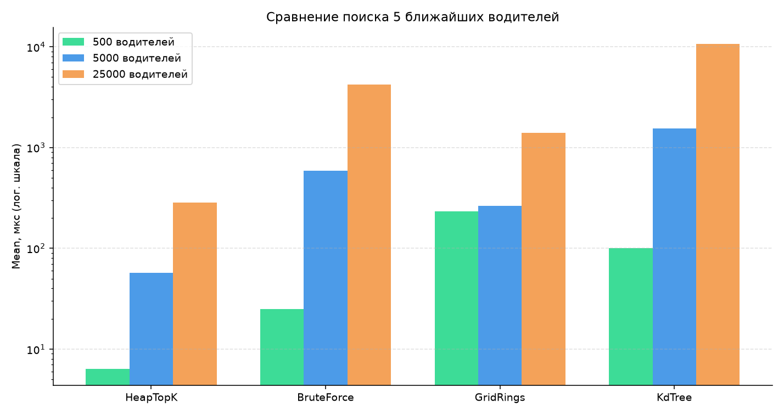

# Подбор ближайших водителей (C#)

Первая часть задания: на карте N×M (клетки 1×1, в клетке не больше одного водителя) нужно найти **пять ближайших** к заказу. Координаты целые, `0 <= X < N`, `0 <= Y < M`. У водителя уникальный Id, его можно добавить или подвинуть.

Расстояние — обычное евклидово. Для сравнений внутри считаем квадрат (`dx² + dy²`), чтобы не ловить погрешность от `sqrt`. Если дистанция одинаковая, берём меньший Id — так все алгоритмы выдают один и тот же набор.

## Что внутри

```
DriverSelection.sln
├── DriverSelection/                 — библиотека
│   ├── DriverStore.cs               — карта, AddOrUpdate, занятость клетки
│   ├── BruteForceFinder.cs          — полный перебор + сортировка
│   ├── HeapTopKFinder.cs            — перебор, куча размера k
│   ├── GridRingFinder.cs            — кольца по сетке
│   └── KdTreeFinder.cs              — KD-дерево
├── DriverSelection.Tests/           — NUnit
├── DriverSelection.Benchmarks/      — BenchmarkDotNet
└── DriverSelection.Demo/            — маленький пример в консоли
```

Четыре алгоритма, все реализуют `INearestDriverFinder`.

## Алгоритмы

**1. Brute force.** Считаем расстояние до каждого водителя, сортируем, берём 5. Простой и всегда правильный, но `O(n log n)` и лишняя память на полный список.

**2. Top-K heap.** Тот же проход по всем, только вместо сортировки всего массива держим кучу из k элементов. Худший из текущих пяти вылетает, если нашли кого-то ближе. `O(n log k)`, при k = 5 это по сути линейный проход. На разовом запросе обычно самый быстрый.

**3. Grid rings.** Карта и так клеточная, поэтому идём от заказа квадратами радиуса 0, 1, 2, … (шахматное расстояние короля). Как только набрали 5 человек и следующее кольцо физически не может быть ближе текущего 5-го — останавливаемся. На плотной карте, когда ближайшие рядом, отрабатывает рано. Если водителей мало и они размазаны по большой карте, придётся обойти кучу пустых клеток, и обычный перебор выигрывает.

**4. KD-tree.** Строим дерево, чередуя разбиение по X и Y, в узле медиана. Поиск с отсечением: дальнюю ветку не смотрим, если до плоскости разреза уже дальше, чем до текущего k-го. Само дерево строится `O(n log n)`. Если строить его на каждый запрос заново, накладные расходы съедают выигрыш. Имеет смысл, когда водители относительно стабильны, а заказов много — дерево собрали один раз и гоняем запросы.

## Запуск

Нужен .NET 8 SDK.

```bash
dotnet test DriverSelection.sln
dotnet run --project DriverSelection.Demo
dotnet run --project DriverSelection.Benchmarks -c Release
```

Демо просто печатает пятёрку с каждого алгоритма, чтобы глазами убедиться, что сходятся.

## Тесты (NUnit)

Покрыто:

- пустая карта, меньше пяти водителей, ровно нужная пятёрка
- водитель стоит в клетке заказа (дистанция 0)
- одинаковое расстояние → меньший Id
- после `AddOrUpdate` ближайший меняется
- две машины в одну клетку — исключение
- все четыре алгоритма на случайных картах возвращают одни и те же Id

```
Passed!  Failed: 0, Passed: 28, Total: 28
```

## Сравнение производительности

Карта 1000×1000, заказ в центре, k = 5. В замер входит всё, что алгоритм делает на одном запросе (для KD-tree — в том числе построение дерева).





Кратко по цифрам (mean):

| алгоритм   | 500 водителей | 5000 | 25000 |
|------------|---------------|------|-------|
| HeapTopK   | 6.3 us        | 57 us | 284 us |
| BruteForce | 25 us         | 586 us | 4.2 ms |
| GridRings  | 234 us        | 265 us | 1.4 ms |
| KdTree     | 101 us        | 1.5 ms | 10.7 ms |

Что из этого видно:

- куча стабильно быстрее полной сортировки, на 25k примерно в 15 раз
- кольца на 500 водителях проигрывают (карта большая, клетки пустые), на 5k и 25k уже обгоняют brute force
- KD-tree здесь самый медленный именно из-за построения на каждый вызов. Для одного заказа это оверкилл. Если бы дерево жило между заказами, картинка была бы другая

Скриншоты лежат в `screenshots/`. Полный отчёт BenchmarkDotNet после прогона появляется в `BenchmarkDotNet.Artifacts/`.
